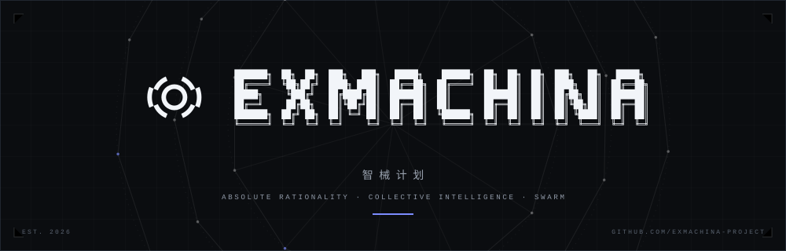
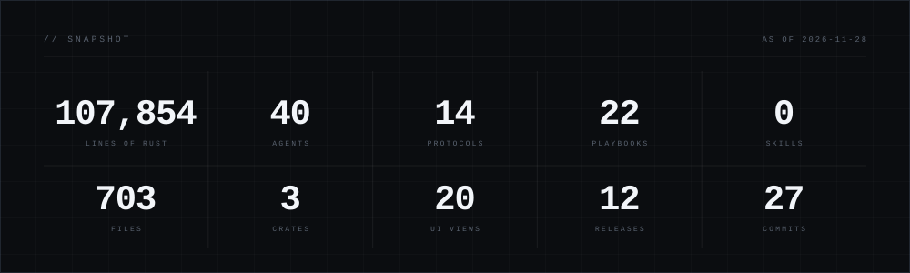
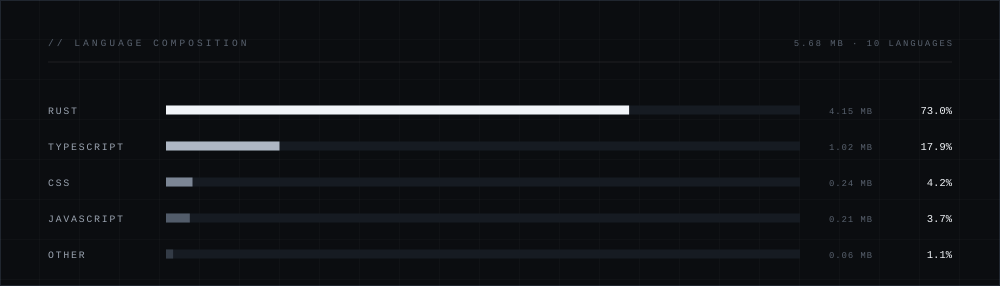
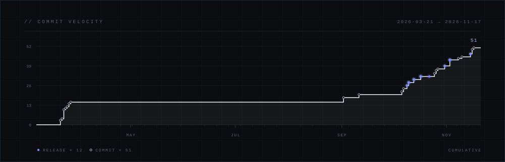

  
  
  
  
  

## 项目

| 01 **[ExMachina](https://github.com/ExMachina-Project/ExMachina)** | 02 **[ExM-WebSite](https://github.com/ExMachina-Project/ExM-WebSite)** | 03 **[ExM-Code](https://github.com/ExMachina-Project/ExM-Code)** |
| :-- | :-- | :-- |
| 以集体智能与集群协作为核心的智能体系统，基于 Rust 构建。  `RUST` `TAURI` `40 AGENTS` | ExMachina 的官方网站与项目门户。 [在线访问 →](https://exmachina-project.pages.dev/)  `TYPESCRIPT` `CLOUDFLARE` | ExMachina 的编程向延伸，四段式 AI 编程工作流。  `RUST` `REACT 19` `TAURI` |

## 数据

## 贡献者

  
   
  感谢每一位贡献者

**智械计划 · ExMachina-Project** © 2026

